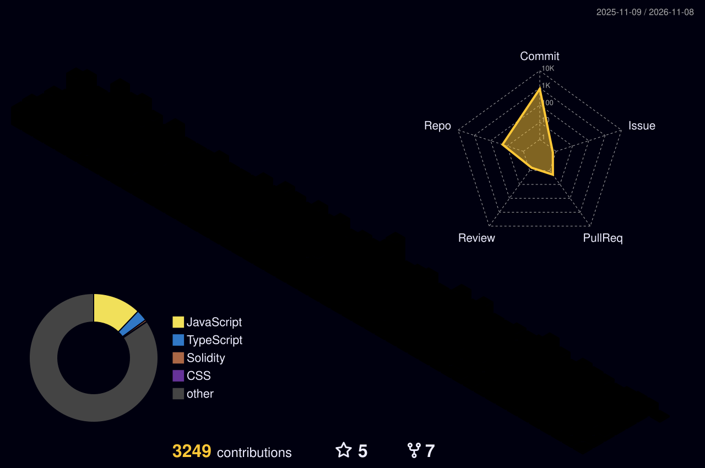

<!-- ============================================================
     HEADER: animated gradient banner (capsule-render)
     ============================================================ -->
<p align="center">
  
</p>

<!-- Animated typing headline -->
<p align="center">
  <a href="https://devsidd.cloud">
    
  </a>
</p>

<!-- Social / contact badges -->
<p align="center">
  <a href="https://devsidd.cloud"></a>
  <a href="https://linkedin.com/in/siddharth-maddheshiya"></a>
  <a href="mailto:bhaisiddharth63@gmail.com"></a>
  
</p>

<p align="center">
  
</p>

<!-- ============================================================
     3D CONTRIBUTION CALENDAR (generated daily by GitHub Actions)
     ============================================================ -->
<p align="center">
  
</p>

---

## `> whoami`

<table>
<tr>
<td width="58%" valign="top">

Backend Developer at **Star Chain Labs**, building payment, real-time and Web3 systems that run in production — where **correctness and idempotency are not optional**.

I own the whole path: **schema → API → integrations → React dashboard → Nginx/PM2 on the server.**

- 🏦 Payments & ledgers that never double-settle
- ⚡ Real-time infra scaled horizontally with Redis
- 🔗 On-chain payouts & staking via ethers.js on BNB Chain
- 🚀 Building **Linkzy** (live paid SaaS) and **ShopSense AI**

</td>
<td width="42%" valign="top">

```js
const siddharth = {
  role:     "Backend Developer",
  company:  "Star Chain Labs",
  location: "Bhopal, India 🇮🇳",
  remote:   true,
  stack:    ["Node.js", "MongoDB",
             "Redis", "React", "Web3"],
  shipping: ["Linkzy", "ShopSense AI"],
  learning: ["PostgreSQL", "Prisma",
             "System Design"],
  motto:    "Make it correct, then fast.",
};
```

</td>
</tr>
</table>

---

## `> impact --production`

<p align="center">
  
  
  
  
</p>

| ⚙️ System | 🧠 How | 📈 Result |
|---|---|---|
| **Atomic settlement engine** | MongoDB transactions, conditional updates, TTL-based locks | No double settlement under 1,000+ concurrent ops |
| **Crypto deposit / withdrawal pipeline** | HMAC-verified webhooks, idempotency keys, reconciliation job + audit logs | Zero duplicate credits |
| **On-chain payouts & staking** | ethers.js, nonce management, gas estimation, block-confirmation tracking | Payouts marked final only after confirmations |
| **Horizontal real-time layer** | Socket.IO + Redis adapter across PM2 cluster instances | Live updates scale across processes |
| **Caching & query tuning** | Redis bucket-based invalidation, compound indexes, leaner aggregations | Faster busiest read endpoints |
| **Access control & rewards** | 5-tier RBAC, hierarchy-scoped queries, ledger-based batch payouts | Full audit trail on every action |
| **VPS fleet** | Nginx load balancing, PM2 cluster, Certbot SSL, GitHub Actions CI/CD | 100+ domains in production |

---

## `> ls ./featured-projects`

<table>
<tr>
<td width="50%" valign="top">

### 🔗 Linkzy &nbsp;
**URL Shortener & Link Analytics SaaS**

Short links, custom aliases, PNG/SVG QR codes, link-in-bio pages, and editable / pausable / expiring links that keep printed QR codes valid.

- 📊 Per-link analytics — source, device, browser, country (7/30/90-day)
- 💳 Razorpay recurring billing — UPI Autopay, cards, netbanking
- 🧱 Free / Starter / Pro plan-based limits


</td>
<td width="50%" valign="top">

### 🛒 Multi-vendor E-commerce &nbsp;
**Customer · Vendor · Admin panels**

Full catalog, cart, checkout, orders and vendor payouts — built for a client and deployed on a self-managed VPS.

- 💰 Razorpay + Cashfree with server-side verification
- 🧩 Three separate role-based panels
- 🛡️ Nginx, PM2 and SSL in production


</td>
</tr>
</table>

---

## `> cat stack.json`

<p align="center">
  <b>Backend & Data</b><br/><br/>
  
</p>
<p align="center">
  <b>Frontend</b><br/><br/>
  
</p>
<p align="center">
  <b>Web3 & DevOps</b><br/><br/>
  
</p>
<p align="center">
  
  
  
  
  
  
</p>

---

## `> git log --stats`

<p align="center">
  
</p>

<!-- Snake eating the contribution grid (generated daily by GitHub Actions into ./dist) -->
<p align="center">
  <picture>
    <source media="(prefers-color-scheme: dark)" srcset="./dist/github-snake-dark.svg"/>
    
  </picture>
</p>

> 🔒 Most of my production work lives in **private client repos**. Happy to walk you through the architecture on a call.

---

<p align="center">
  
</p>

<!-- FOOTER banner -->

